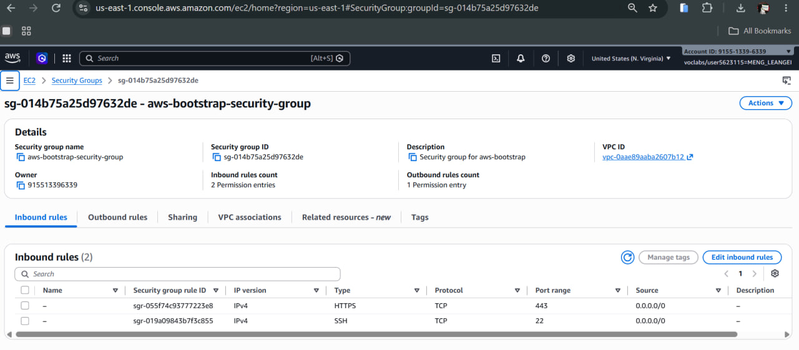
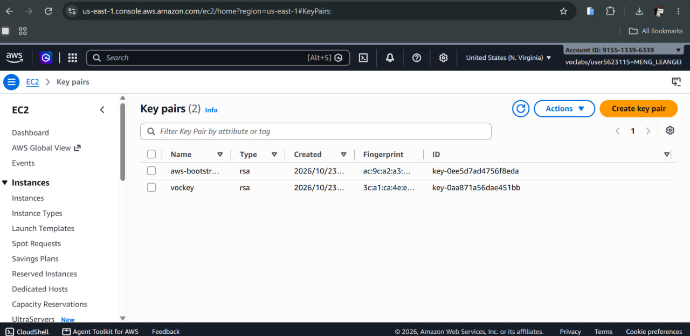
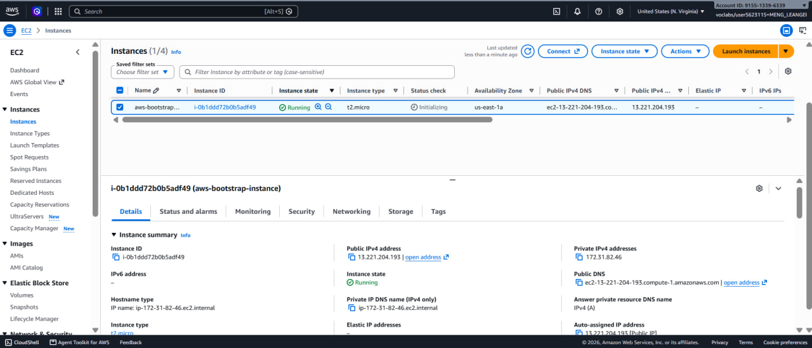
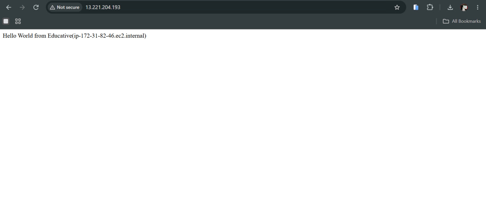
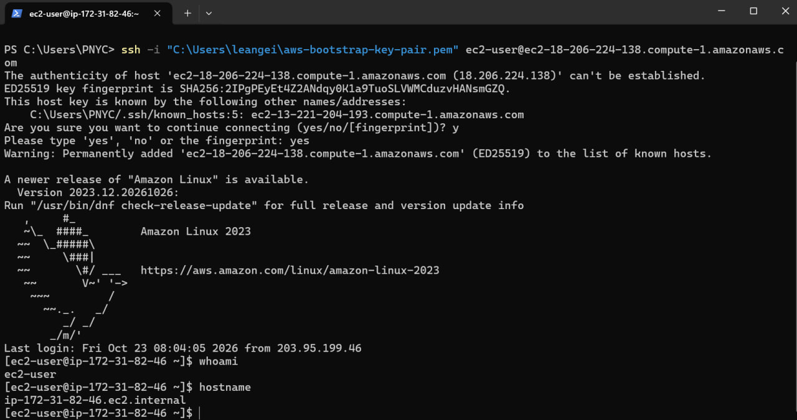
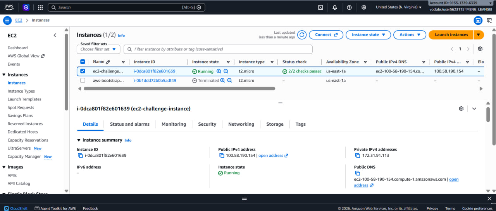
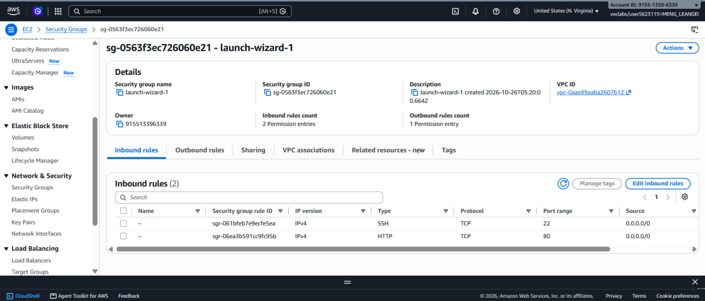
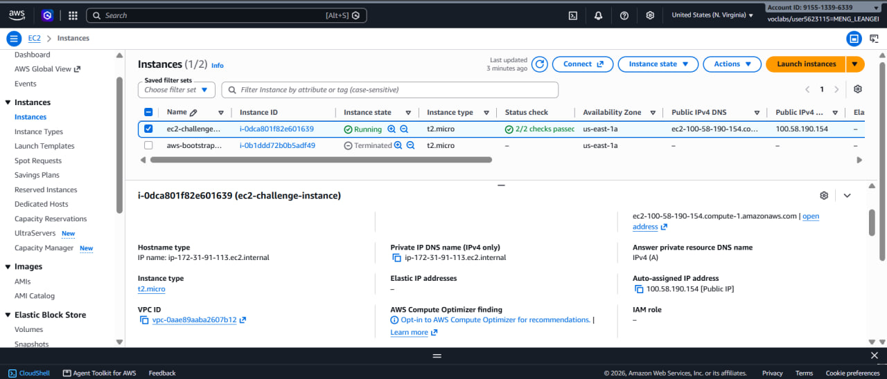
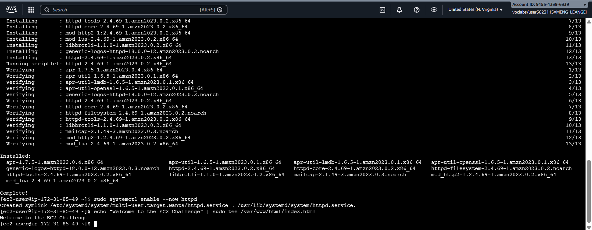
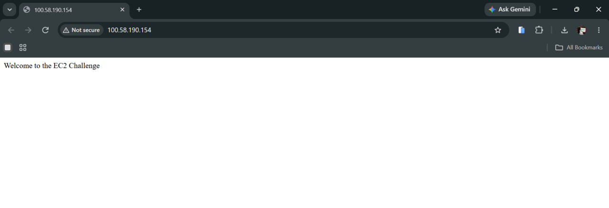

# Cloud Lab 1 Submission — Amazon EC2

- **Student name:** MENG LEANGEI
- **Student ID:** e20221618
- **Learner Lab user name:** user5623115 (voclabs/user5623115=MENG_LEANGEI)
- **Date completed:** 2026-10-26

---

## Part 1.1 — An Amazon EC2 Walkthrough

### Security group



### Key pair



### Instance details



### Browser test



### SSH connection



**Did you connect with your own SSH client or with EC2 Instance Connect?**

I used my own SSH client: the built-in OpenSSH client in Windows PowerShell, with the downloaded `.pem` key:

```powershell
ssh -i "C:\Users\leangei\aws-bootstrap-key-pair.pem" ec2-user@ec2-18-206-224-138.compute-1.amazonaws.com
```

After logging in, I ran `whoami` (`ec2-user`) and `hostname` (`ip-172-31-82-46.ec2.internal`) to confirm I was on the right instance.

---

## Part 1.2 — EC2 Web Solution (Challenge)

### Launch configuration



### Security group



### Running instance



### Commands on the instance



**Paste the commands you ran to install the web server and create index.html:**

```bash
# Install the Apache web server
sudo dnf install -y httpd

# Start Apache now and make it start on every boot
sudo systemctl enable --now httpd

# Create the home page
echo "Welcome to the EC2 Challenge" | sudo tee /var/www/html/index.html
```

### Browser test



---

## Questions

**1. Your security group has an SSH rule and an HTTP rule. What does each one let you do? What would stop working if you deleted the HTTP rule?**

- The **SSH rule** (TCP port 22) allows inbound connections to the SSH service, so I can log in to the instance remotely with my key pair and run commands.
- The **HTTP rule** (TCP port 80) allows inbound web traffic, so a browser can reach the Apache web server and load the page.
- If I deleted the HTTP rule, the web page would stop loading in the browser. The request would time out because the security group drops traffic on port 80. Apache would still be running, and SSH would still work, but nobody outside the instance could see the website.

**2. In Part 1.1 you never logged in to install the web server. What installed it, and when did it run?**

The **user data** script, a bootstrap script entered under *Advanced details → User data* when launching the instance. EC2 passes it to **cloud-init**, which runs it as root **once, on the instance's first boot**. The script installed and started the web server and wrote the "Hello World from Educative (hostname)" page, so the site was ready without me logging in.

**3. Why does the web page open with `http://` but not with `https://`?**

The web server only listens on port 80 (plain HTTP). HTTPS needs port 443 open in the security group **and** a web server set up for TLS with an SSL certificate (for example `mod_ssl` and a certificate). None of that was configured, so an `https://` request has nothing answering it and fails. This is also why the browser shows "Not secure" in the screenshots.

**4. Part 1.2 asked for a 10 GiB root volume. Where in the launch settings did you set it, and how can you check the size on the running instance?**

- **Where:** On the Launch instance page, in the **Configure storage** section, I changed the root volume (gp3) size from the default 8 GiB to **10 GiB**.
- **How to check:**
  - In the console: select the instance → **Storage** tab → the root device's volume shows **10 GiB** (or under *Elastic Block Store → Volumes*).
  - On the instance:
    ```bash
    lsblk          # the root disk (xvda / nvme0n1) shows 10G
    df -h /        # size of the root filesystem (about 10G)
    ```

---

## Problems and how I solved them (optional)

- **Public IP changed:** My Part 1.1 instance got a new public IP (13.221.204.193 → 18.206.224.138) after it was stopped and started, so SSH showed a "host authenticity" warning for the new address. I used the new public DNS name from the console and typed `yes` to accept the host key.
- **Screenshot file names:** Some screenshots were saved as `.png.png`. I renamed them to match the names in this README so the images display.

## AI note (optional)

**One suggestion an AI tool gave you and how you checked it.**

An AI tool suggested `sudo systemctl enable --now httpd` instead of running `start` and `enable` separately, so Apache starts now and also after a reboot. I checked it by reading the output (`Created symlink ... httpd.service`), which shows it was enabled, and by opening the public IP in a browser, which showed "Welcome to the EC2 Challenge".

---

## Clean up

- [ ] Part 1.1: instance terminated, key pair and security group deleted.
- [ ] Part 1.2: instance terminated, security group (and key pair, if any) deleted.
