# Cloud Lab 2 Submission — Load Balancer and Auto Scaling

- **Student name:** MENG LEANGEI
- **Student ID:** e20221618
- **Learner Lab user name:** voclabs/user5623115=MENG_LEANGEI
- **Date completed:** 2026-10-30

---

## Security groups

`LoadBalancerSecurityGroup` (sg-090c0b41572a448c5): inbound HTTP (TCP 80) from 0.0.0.0/0.

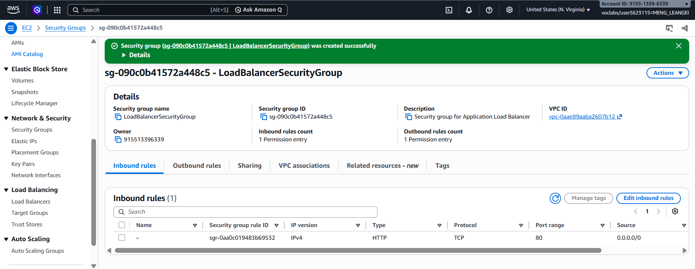

`LaunchTemplateSecurityGroup` (sg-06630d50fbf95c941): inbound HTTP (TCP 80) from 0.0.0.0/0.

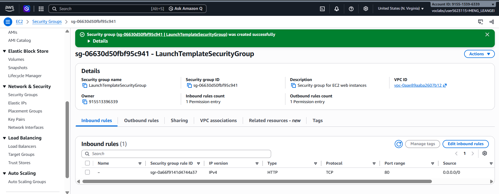

## Target group

`LoadBalancerTargetGroup`: target type *Instance*, HTTP on port 80, IPv4.

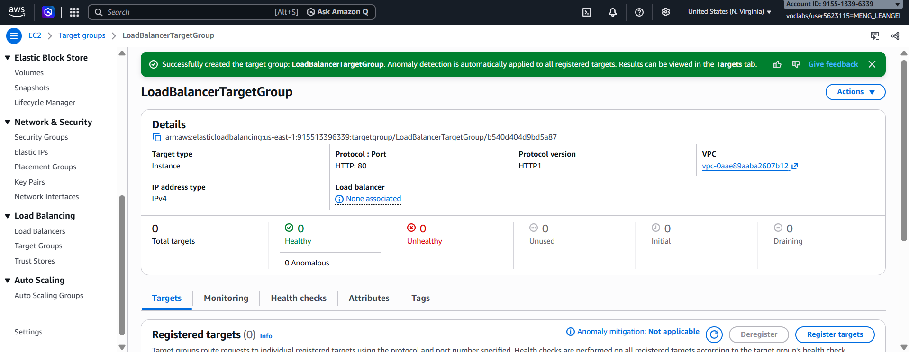

After the Auto Scaling group registered its instances: 2 targets, both healthy.

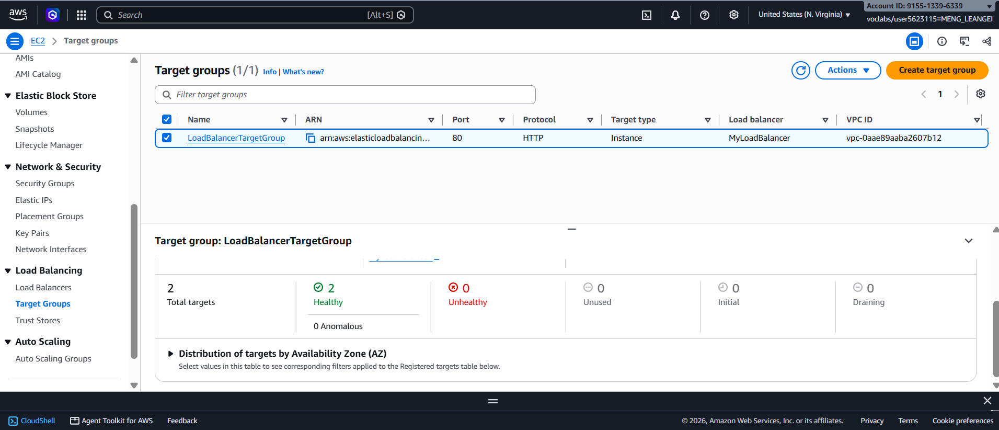

## Application Load Balancer

`MyLoadBalancer`: Application Load Balancer, internet-facing, IPv4, in 2 Availability Zones (us-east-1a and us-east-1b), using `LoadBalancerSecurityGroup`.

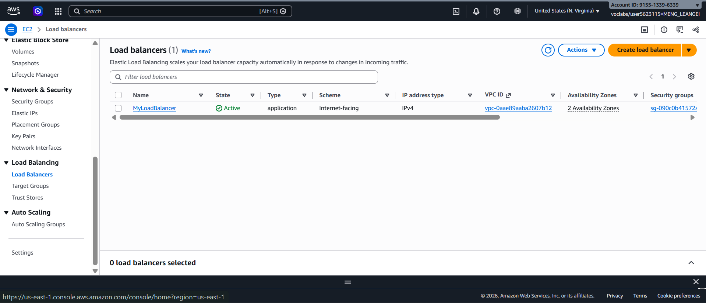

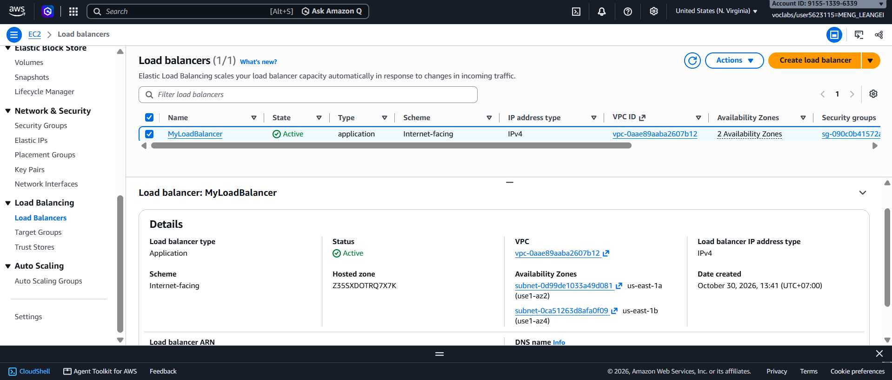

## Launch template

`AutoScalingLaunchTemplate` (lt-03de8fc9251d28b07), version 1.

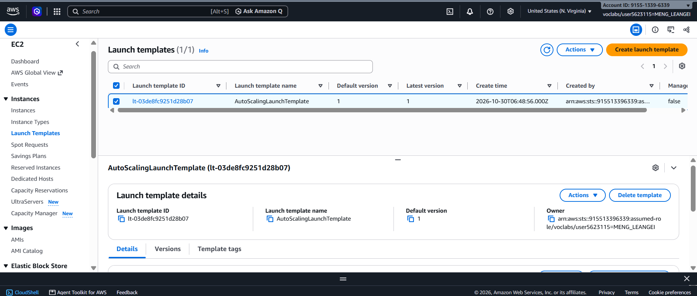

## Auto Scaling group

`MyAutoScalingGroup`: uses `AutoScalingLaunchTemplate`, desired capacity 2, scaling limits 2–3, status *At desired capacity*, 2/2 healthy.

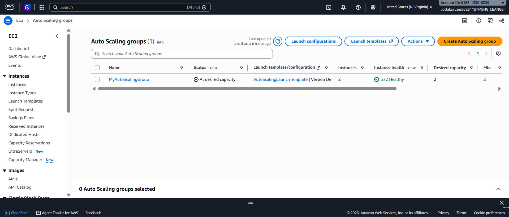

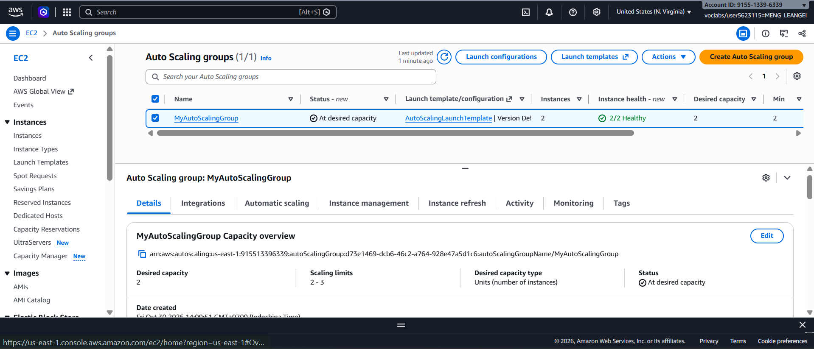

## Load balancing test

I opened the load balancer DNS name `http://myloadbalancer-1321922263.us-east-1.elb.amazonaws.com`.

First request answered by `ip-172-31-86-242.ec2.internal`:

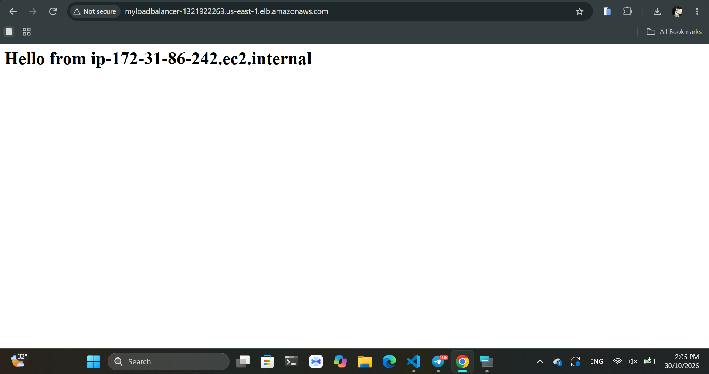

After refreshing, answered by a different host, `ip-172-31-12-234.ec2.internal`:

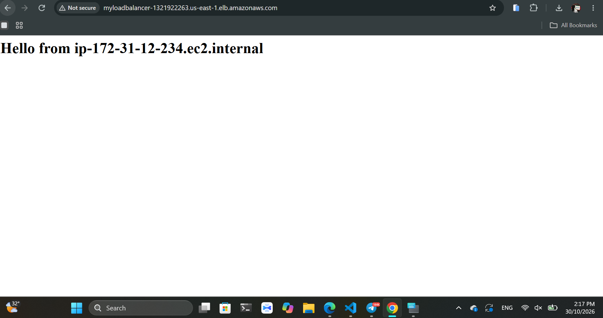

## Simulated application failure

I connected to instance `i-046f709db65e204a4` (`ip-172-31-12-234`) and stopped the web server:

```bash
sudo systemctl stop httpd
sudo systemctl status httpd   # Active: inactive (dead) since 07:32:42 UTC
```

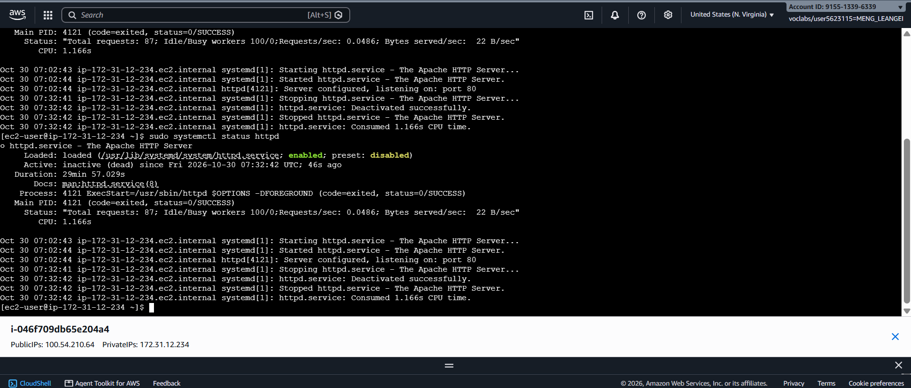

The target group then showed 1 healthy, 1 unhealthy and 1 draining target:

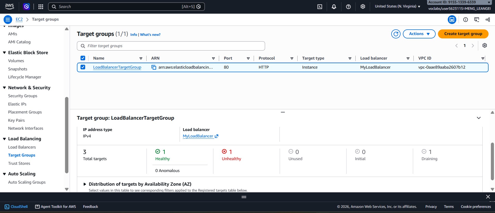

The Auto Scaling group replaced the failed instance, and the target group was back to 2 healthy targets (`i-051d1e3e1b11d2519` and `i-06c15d76259260aa6`):

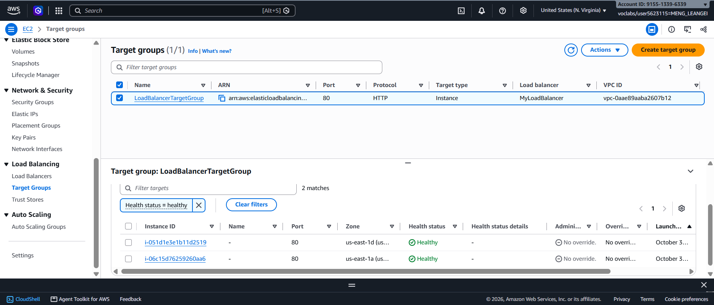

**About how many minutes passed between stopping `httpd` and the new instance becoming healthy?**

About **5 minutes**. I stopped `httpd` at 07:32 UTC (14:32 local time). It took about 1–2 minutes for the health checks to mark the instance unhealthy, then a few more minutes for Auto Scaling to launch a new instance, run the user data script and pass the health checks.

---

## Questions

**1. Why does the page show a different host name when you refresh it?**

The load balancer spreads requests across all healthy instances in the target group (round robin by default). Each page shows the host name of the instance that served it, so a refresh can go to the other instance and show a different host name. In my test, the first request came from `ip-172-31-86-242` and the next from `ip-172-31-12-234`.

**2. After you stopped `httpd`, the instance was still *running* in EC2, but the target group marked it *unhealthy*. What did the health check test, and why did the instance fail it?**

The health check does not test whether the VM is running. It sends an **HTTP request to the health check path (`/`) on port 80** and expects a **200 OK** response. After `httpd` was stopped, nothing was listening on port 80, so the request was refused. After several failed checks in a row (the unhealthy threshold), the target group marked the instance unhealthy, even though EC2 still showed it as *running* (EC2 status checks only test the hardware and the operating system).

**3. Who replaced the failed instance: the load balancer, the target group, or the Auto Scaling group? Explain the role of each one.**

The **Auto Scaling group** replaced it.

- **Load balancer:** the single entry point (one DNS name). It accepts client requests on its listener (HTTP :80) and forwards them to the target group. It never creates or deletes instances.
- **Target group:** the list of instances that receive traffic. It runs the health checks and only sends traffic to healthy targets. It drains the unhealthy one but does not replace it.
- **Auto Scaling group:** keeps the right number of healthy instances running. With ELB health checks turned on, it saw the target was unhealthy, terminated that instance, and launched a new one from the launch template. It registered the new instance in the target group to get back to the desired capacity of 2.

**4. With desired 2, minimum 2 and maximum 3, how many instances run normally? In what situation could there be 3?**

Normally **2** instances run (the desired capacity). There could be **3** when:

- a **scaling policy** scales out under high load (for example, high CPU or many requests per target), up to the maximum of 3; or
- for a short time **during a replacement**, as in my test: the new instance was launched while the old unhealthy one was still draining, so the target group briefly showed 3 targets.

**5. The instances' security group allows HTTP from anywhere. How could you change it so that the instances accept HTTP only from the load balancer?**

Edit the inbound rules of `LaunchTemplateSecurityGroup`: delete the HTTP rule with source `0.0.0.0/0` and add an HTTP (TCP 80) rule whose **source is the security group `LoadBalancerSecurityGroup`** (sg-090c0b41572a448c5) instead of an IP range. Then only traffic coming from the load balancer can reach the instances on port 80. Users can still open the site through the load balancer DNS name, but not by going straight to an instance's public IP.

---

## Problems and how I solved them (optional)

- Right after creating the target group it showed **0 targets** and "None associated". This was expected: the instances are registered only after the Auto Scaling group is created and attached to the target group. After that it showed 2 healthy targets.
- The new instances need a few minutes to boot and pass health checks, so I refreshed the target group page until the targets turned **Healthy**.

## AI note (optional)

**One suggestion an AI tool gave you and how you checked it.**

An AI tool suggested using `sudo systemctl status httpd` after stopping the service, to confirm it really stopped. I checked the output: it showed `Active: inactive (dead)`. I also checked the target group, which then marked that instance as unhealthy.

---

## Clean up

- [ ] `MyAutoScalingGroup` deleted and its instances terminated.
- [ ] `AutoScalingLaunchTemplate` deleted.
- [ ] `MyLoadBalancer` and `LoadBalancerTargetGroup` deleted.
- [ ] Both security groups deleted.
