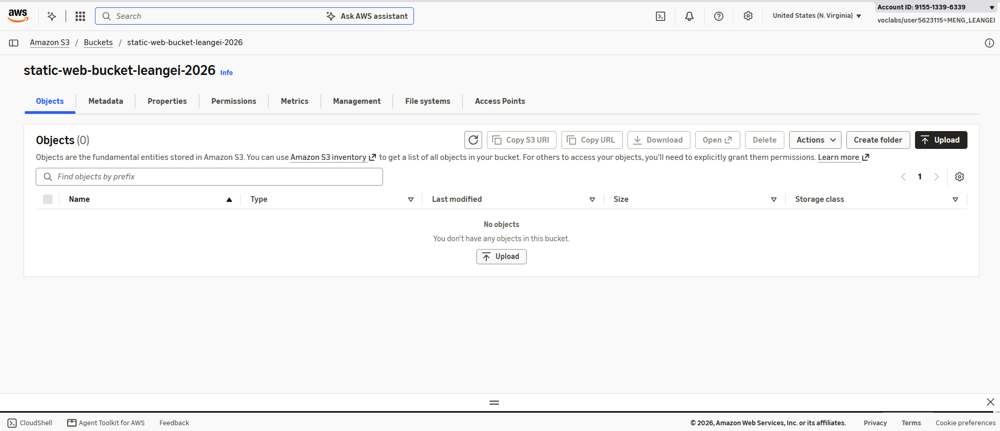
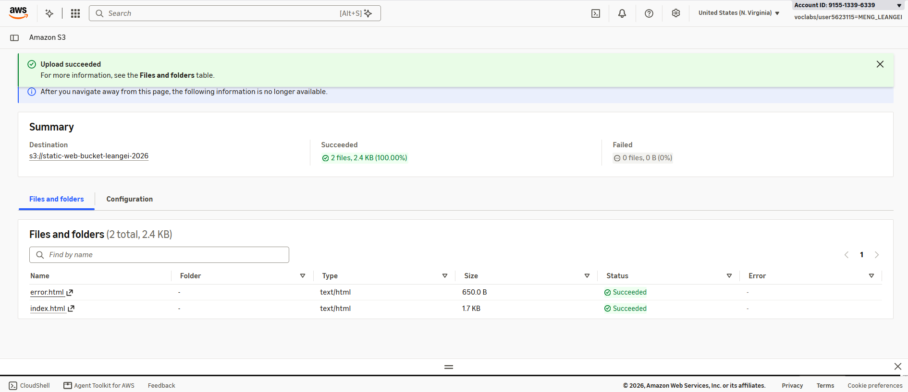
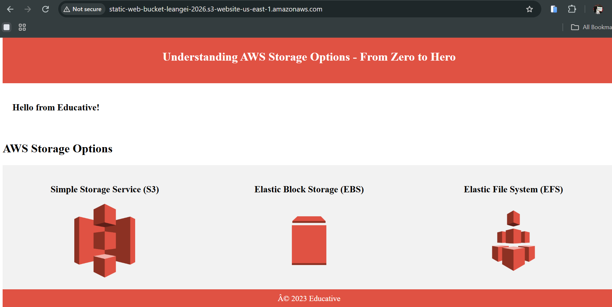
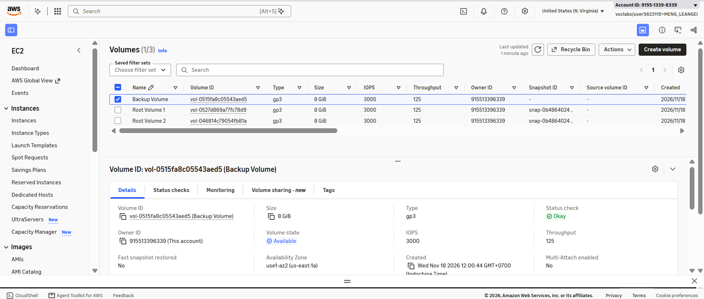
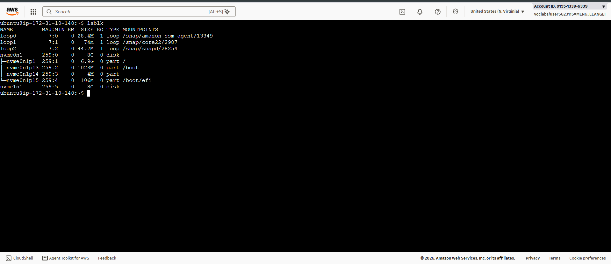
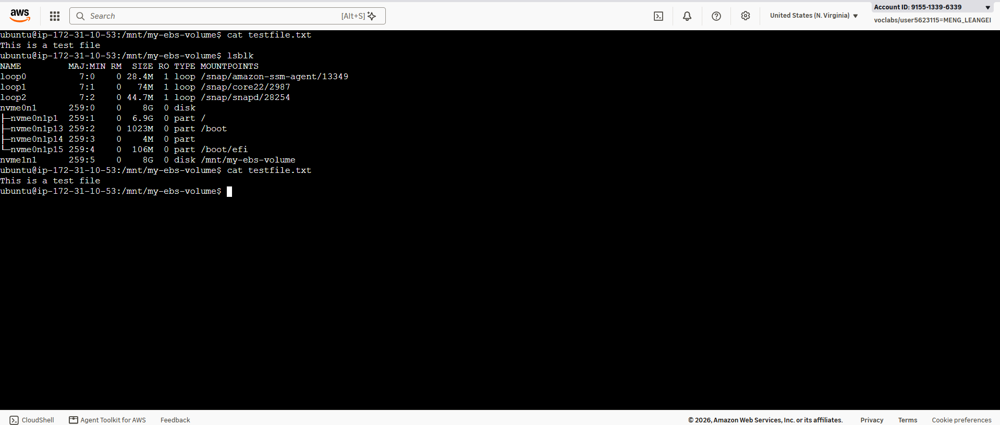
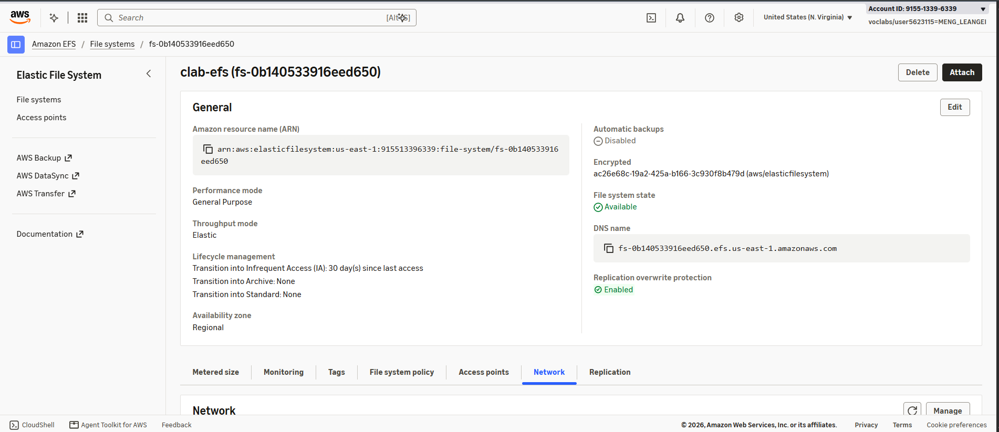
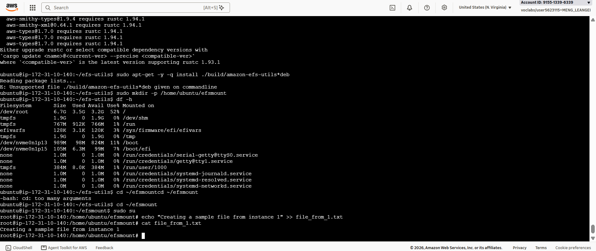
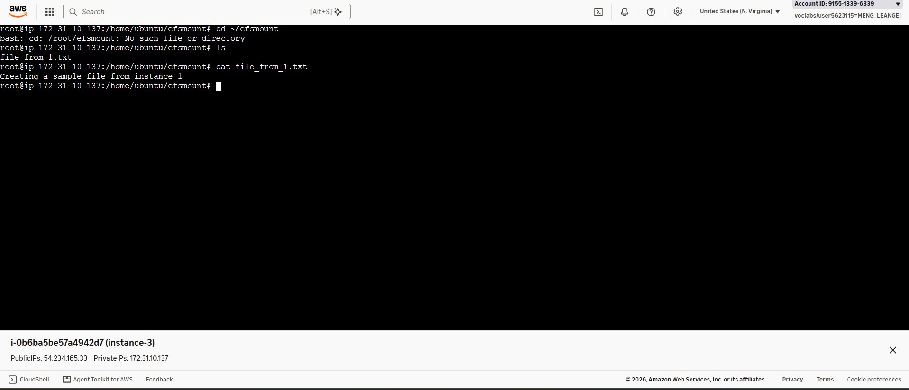

# Cloud Lab 3 Submission - AWS Storage Options

- **Student name:** MENG LEANGEI
- **Student ID:** e20221618
- **Learner Lab user name:** voclabs/user5623115=MENG_LEANGEI
- **Region:** US East (N. Virginia) `us-east-1`
- **Date completed:** 2026-11-18

---

## Summary of resources

| Resource | Name | Purpose |
|---|---|---|
| Amazon S3 bucket | (bucket name used in the lab) | Static website hosting and object storage |
| Amazon EBS volume | `Backup Volume` | Block storage attached and detached between EC2 instances |
| Amazon EFS file system | `clab-efs` | Shared file storage mounted by multiple EC2 instances |
| EC2 instance | `instance-1` | Initial EBS formatting/mounting and EFS write test |
| EC2 instance | `instance-2` | EBS read test and volume attachment target |
| EC2 instance | `instance-3` | EFS read test |

---

## Part 2.1 - Amazon S3

### Bucket list

### Uploaded files

### Static website

---

## Part 2.2 - Amazon EBS

### Volumes page

### Attached volume (`lsblk`)

The volume was detected as **`nvme1n1`** in `lsblk`.

### File read on instance-2

---

## Part 2.3 - Amazon EFS

### File system and mount targets

### File created on instance-1

### File listed on instance-3

---

## Questions

1. **After static website hosting was enabled, why did the endpoint initially return 403 Forbidden, and what changed after the bucket policy was added?**

   Amazon S3 initially returned `403 Forbidden` because static website hosting does not make the objects publicly readable. The website endpoint could receive the request, but S3 denied access to the private objects. Adding the public read bucket policy granted the website users permission to read the objects, allowing the endpoint to serve `index.html` and the other website files.

2. **Why did `testfile.txt` remain after moving `Backup Volume` to `instance-2`? What would happen to a file saved on `instance-1`'s root volume after terminating `instance-1`?**

   `testfile.txt` remained because it was stored on the separate `Backup Volume`, which is persistent EBS block storage. Detaching and attaching that volume preserved its filesystem and data. A file saved only on `instance-1`'s root volume would normally be deleted when `instance-1` is terminated if the root volume has the default delete-on-termination setting. It would remain only if deletion on termination had been disabled.

3. **Why was `mkfs` run on `instance-1` but not on `instance-2`?**

   `mkfs` creates a new filesystem and was run while initializing the new EBS volume for the first time on `instance-1`. Running it again on `instance-2` would destroy or overwrite the existing filesystem and data. `instance-2` only needed to mount the already-formatted volume.

4. **Why could `instance-1` and `instance-3` use EFS at the same time while an EBS volume had to be detached first? Why did they need to be in the subnets of the mount targets?**

   EFS is a managed network file system designed for concurrent access by many EC2 instances. EBS is block storage designed primarily for attachment to one instance at a time, so another instance requires the volume to be detached first. The instances had to be in the mount-target subnets, or have network routes and security-group access to them, because mount targets provide the NFS endpoints in a VPC subnet.

5. **For each need, choose S3, EBS or EFS and give one reason:**

   | Need | Choice | Reason |
   |---|---|---|
   | (a) A website's images | **S3** | It provides durable object storage and can serve objects directly or through a website or CDN. |
   | (b) The disk of a database server | **EBS** | It provides low-latency persistent block storage attached to the database server. |
   | (c) A folder shared by several web servers | **EFS** | It provides a shared, POSIX-style network file system that multiple instances can mount concurrently. |

---

## Problems and how I solved them (optional)

- No significant problems occurred during the lab.

## AI note (optional)

- No AI tool was used to complete this lab.

---

## Clean up

- [ ] Instances `instance-1`, `instance-2`, `instance-3` terminated.
- [ ] `clab-efs` and **Backup Volume** deleted.
- [ ] Security groups `efs-sg` and `ec2instances-sg` deleted.
- [ ] S3 bucket emptied and deleted.

## What I learned

- Amazon S3 is object storage suitable for files and static website content.
- Amazon EBS provides persistent block storage that is attached to an EC2 instance.
- An EBS filesystem must be created once before the volume can store files.
- Amazon EFS provides concurrent shared file storage across multiple EC2 instances.
- Mount targets and security-group rules control which subnets and instances can access EFS.
