# Cloud Lab 4 Submission — Amazon VPC with Public and Private Subnets

- **Student name:** MENG LEANGEI
- **Student ID:** e20221618
- **Learner Lab user name:** voclabs/user5623115=MENG_LEANGEI
- **Region:** US East (N. Virginia) `us-east-1`
- **Date completed:** 2026-11-06

---

## Summary of resources

| Resource | Name | ID | Details |
|---|---|---|---|
| VPC | `lab4-vpc` | vpc-02cfdecceab51ef93 | IPv4 CIDR `10.0.0.0/24` |
| Internet gateway | `lab4-internet-gateway` | igw-02ad4242e85ec4f32 | Attached to `lab4-vpc` |
| Public subnet | `lab4-public-subnet` | subnet-05c996449f9dc96a9 | `10.0.0.0/25`, us-east-1a |
| Private subnet | `lab4-private-subnet` | subnet-0da4fb3f1fc062abb | `10.0.0.128/25`, us-east-1a |
| Public route table | (main table of `lab4-vpc`) | rtb-04f8cc9cff20dc112 | `0.0.0.0/0` → internet gateway |
| NAT gateway | `lab4-nat-gateway` | nat-083a582d5deb744f5 | Public, in `lab4-public-subnet`, Elastic IP `35.168.67.167` |
| Private route table | `lab4-custom-route-table` | rtb-0b280619195038503 | `0.0.0.0/0` → NAT gateway |
| EC2 (public) | `lab4-ec2-01` | i-0b7712cc6903a9072 | Private IP `10.0.0.94`, public IP `54.157.206.134` |
| EC2 (private) | `lab4-ec2-02` | i-057bed95bceaaf18e | Private IP `10.0.0.199`, no public IP |

## Task 1 — VPC

`lab4-vpc` (vpc-02cfdecceab51ef93) created with IPv4 CIDR `10.0.0.0/24`, no IPv6, default tenancy.

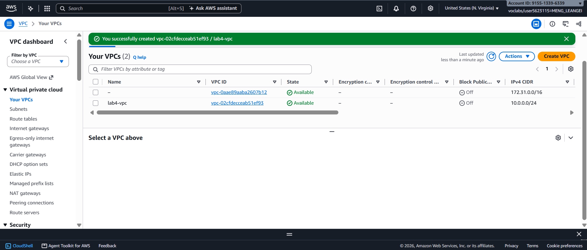

## Task 2 — Internet gateway

`lab4-internet-gateway` (igw-02ad4242e85ec4f32) is *Attached* to `lab4-vpc`.

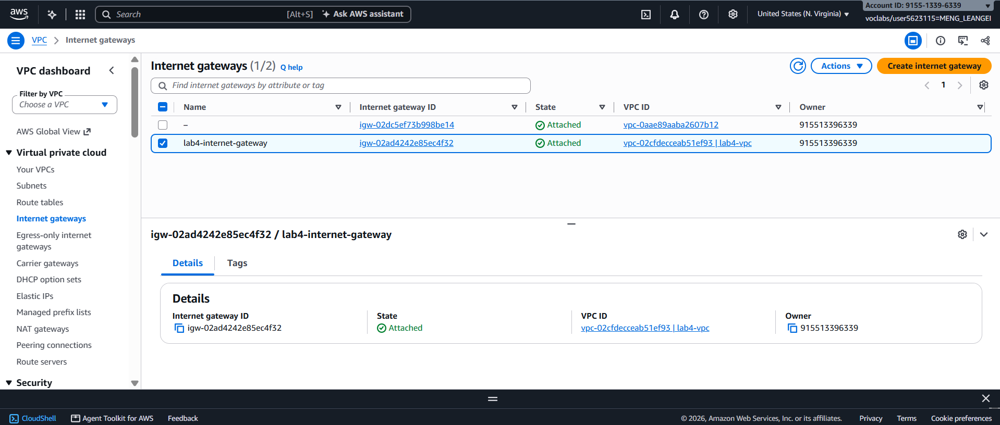

## Task 3 — Public subnet

`lab4-public-subnet` (subnet-05c996449f9dc96a9) in us-east-1a with CIDR `10.0.0.0/25` (addresses 10.0.0.0 – 10.0.0.127).

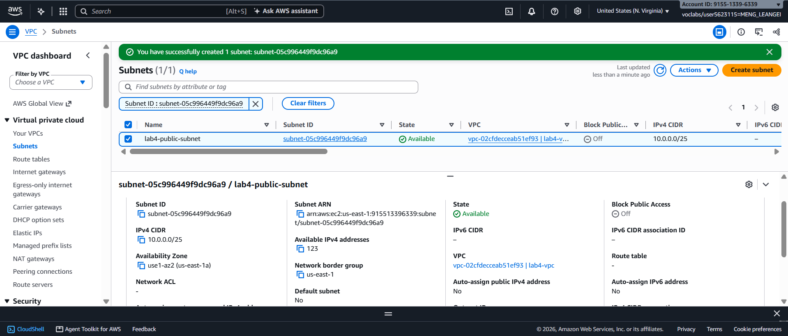

## Task 4 — Public route table

Route table rtb-04f8cc9cff20dc112 of `lab4-vpc` has two routes:

| Destination | Target |
|---|---|
| `10.0.0.0/24` | `local` |
| `0.0.0.0/0` | `lab4-internet-gateway` (igw-02ad4242e85ec4f32) |

It is explicitly associated with `lab4-public-subnet`. The route to the internet gateway is what makes the subnet public.

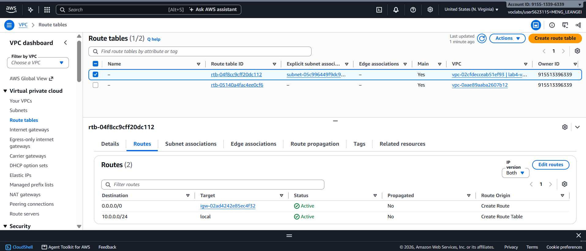

## Task 5 — EC2 instance in the public subnet

`lab4-ec2-01` (i-0b7712cc6903a9072): Amazon Linux 2, t2.micro, us-east-1a, *Running*, with private IP `10.0.0.94` (inside `lab4-public-subnet`) and auto-assigned public IP `54.157.206.134`. Instance profile `LabInstanceProfile`, security group with no inbound rules.

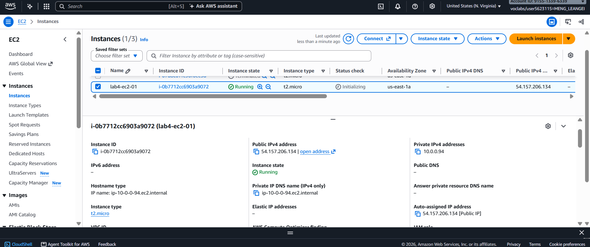

## Task 6 — Internet test from the public subnet

Systems Manager Run Command, document `AWS-RunShellScript`, command `sudo yum update -y` on `lab4-ec2-01`. Command ID `7c7cd38a-ce19-4f15-a8ec-08957829fa61`: **Status** and **Detailed Status** both *Success*. The instance reached the internet through the internet gateway.

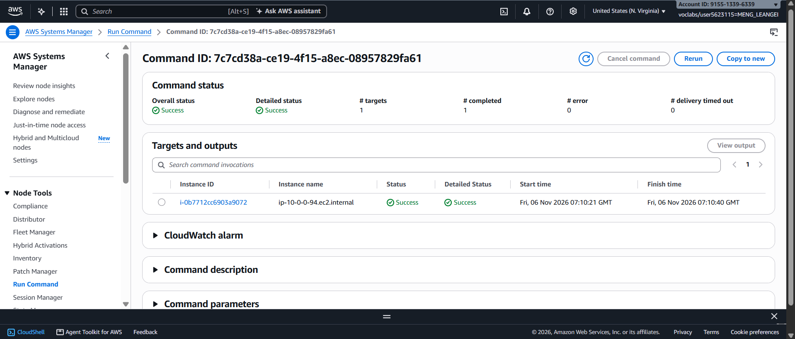

## Task 7 — Private subnet

`lab4-private-subnet` (subnet-0da4fb3f1fc062abb) in us-east-1a with CIDR `10.0.0.128/25` (addresses 10.0.0.128 – 10.0.0.255).

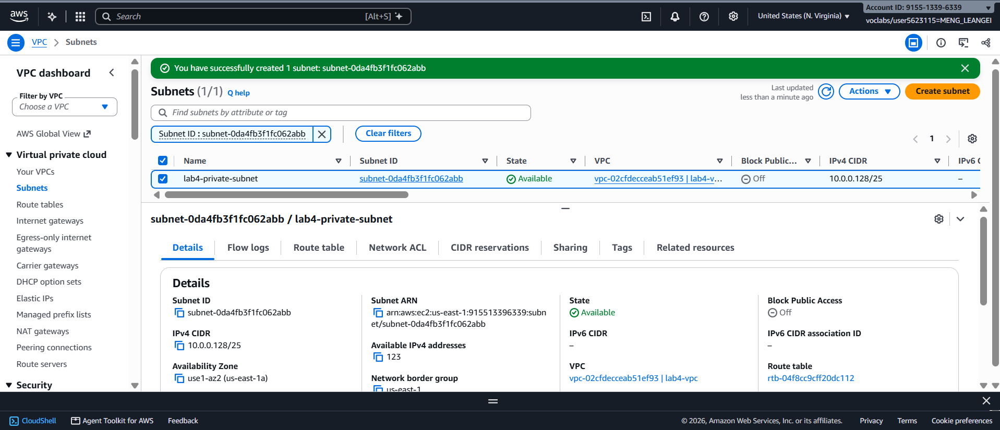

## Task 8 — NAT gateway

`lab4-nat-gateway` (nat-083a582d5deb744f5): connectivity type *Public*, state *Available*, in `lab4-public-subnet`, with Elastic IP `35.168.67.167` and private IP `10.0.0.50`.

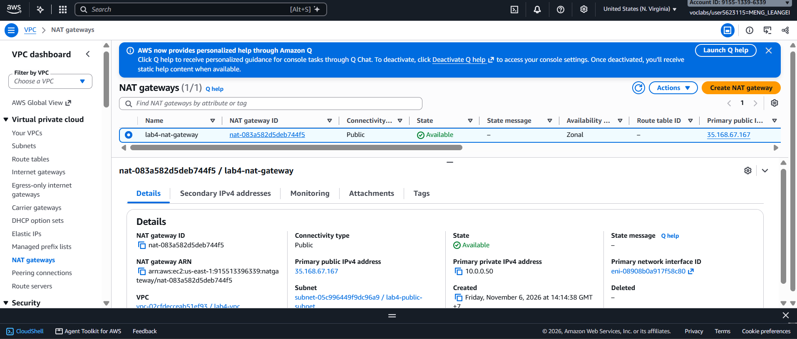

## Task 9 — Private route table

`lab4-custom-route-table` (rtb-0b280619195038503) has two routes and is explicitly associated with `lab4-private-subnet`:

| Destination | Target |
|---|---|
| `10.0.0.0/24` | `local` |
| `0.0.0.0/0` | `lab4-nat-gateway` (nat-083a582d5deb744f5) |

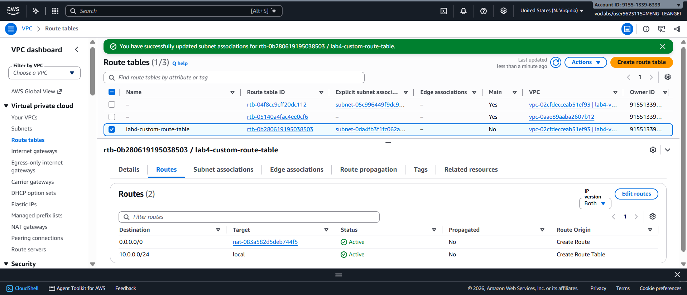

## Task 10 — EC2 instance in the private subnet

`lab4-ec2-02` (i-057bed95bceaaf18e): Amazon Linux 2, t2.micro, us-east-1a, *Running*, with private IP `10.0.0.199` (inside `lab4-private-subnet`) and **no public IPv4 address**. Instance profile `LabInstanceProfile`, security group with no inbound rules.

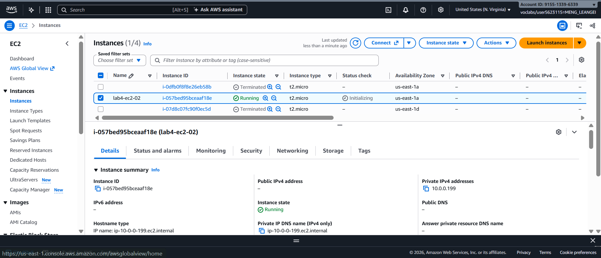

## Task 11 — Internet test from the private subnet

Run Command `AWS-RunShellScript` with `sudo yum update -y` on `lab4-ec2-02`. Command ID `b70fd61f-9b2b-4fe3-a34c-10528b641f3a`: **Status** and **Detailed Status** both *Success*. The private instance reached the internet through the NAT gateway, without a public IP of its own.

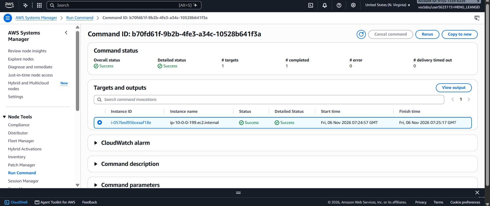

## Task 12 — Clean up

After taking the screenshots: terminated both instances, removed the `0.0.0.0/0` routes, deleted the NAT gateway, released its Elastic IP, detached and deleted the internet gateway, and deleted `lab4-vpc`.

## What I learned

- A **public subnet** is a subnet whose route table sends `0.0.0.0/0` to an internet gateway. Its instances need a public IP to be reached from, or to talk to, the internet directly.
- A **private subnet** has no route to the internet gateway. Its instances have only private IPs and cannot be reached from the internet.
- A **NAT gateway** sits in the public subnet. The private subnet's route table sends `0.0.0.0/0` to it, so private instances can start outbound connections (for example, downloading updates) while staying unreachable from outside.
- Each subnet uses exactly one route table, so the public and private subnets need separate route tables.
- **SSM Run Command** can run commands on an instance with no SSH key and no inbound security group rules, as long as the instance has an IAM role allowing SSM and can reach the SSM service.
