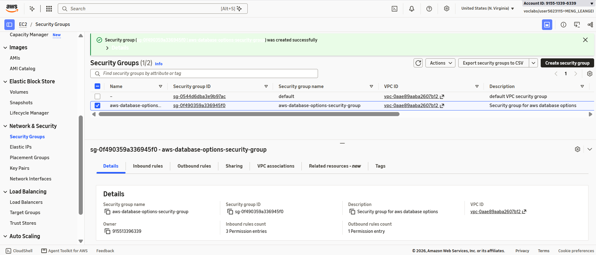
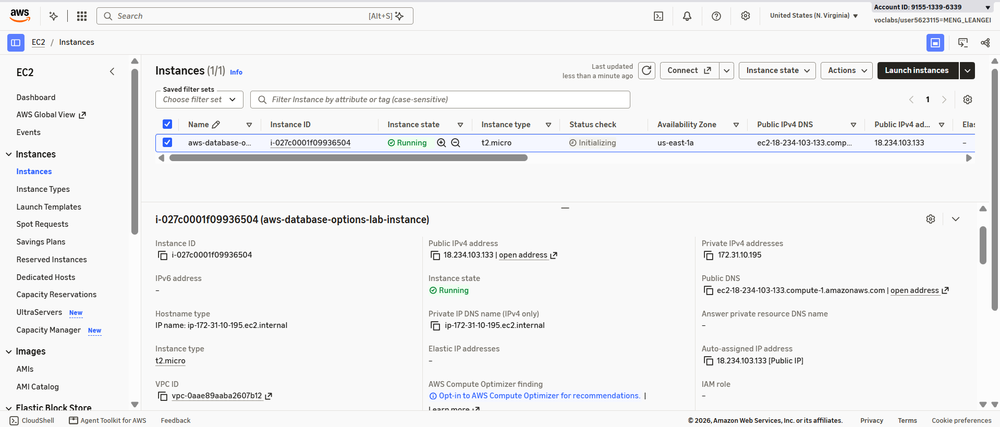
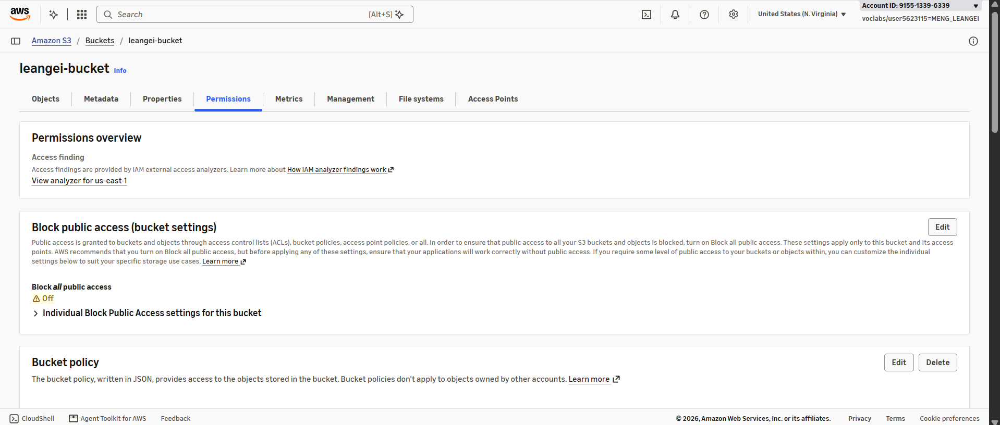
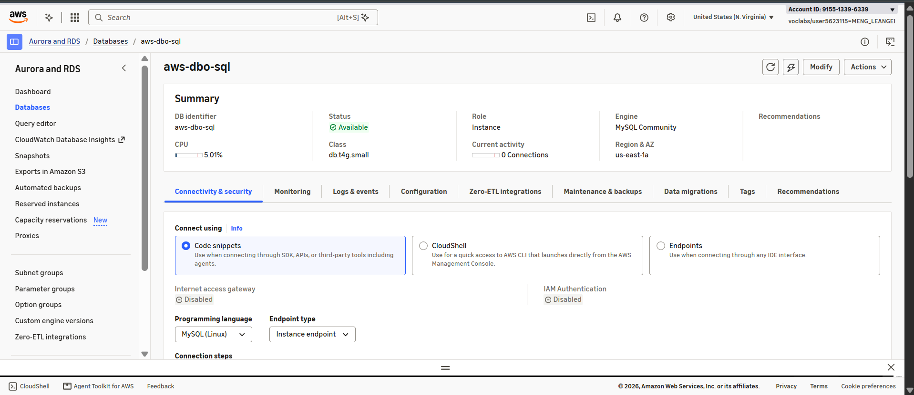
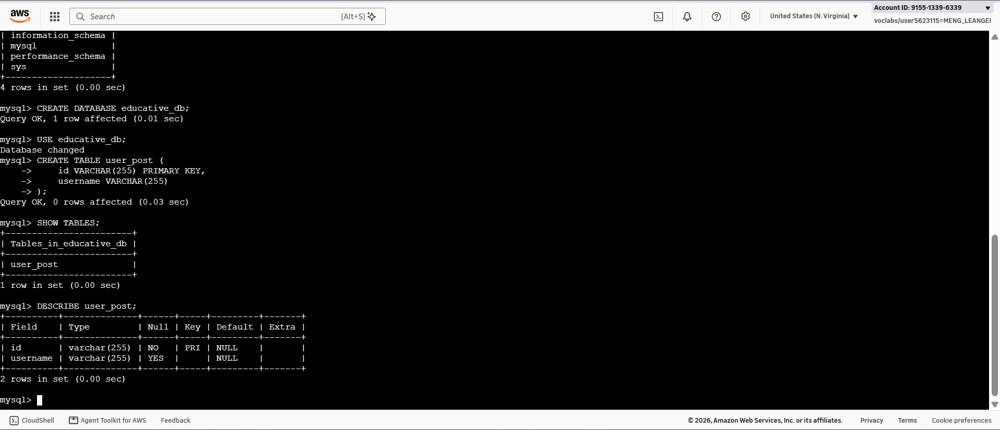
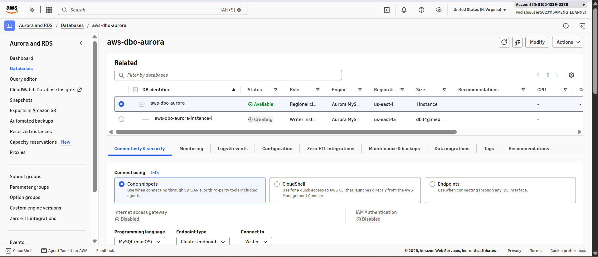
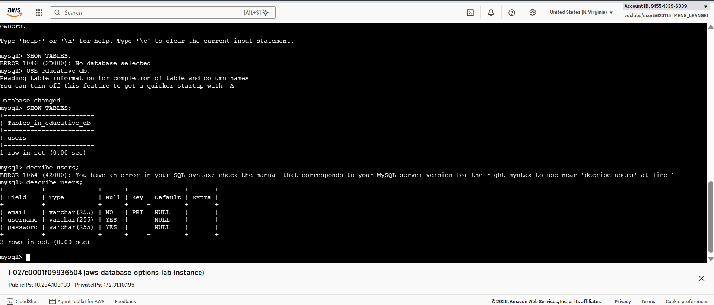
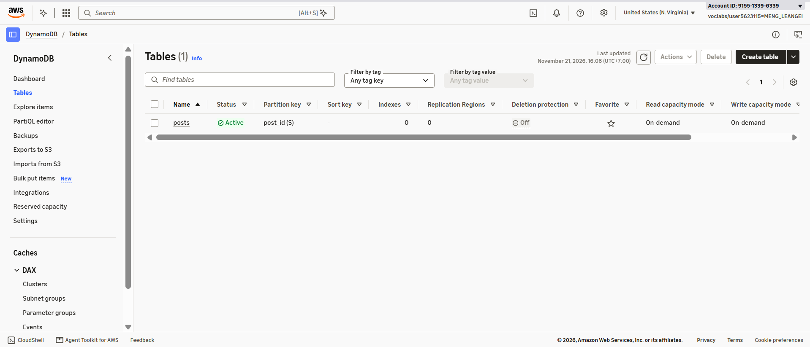
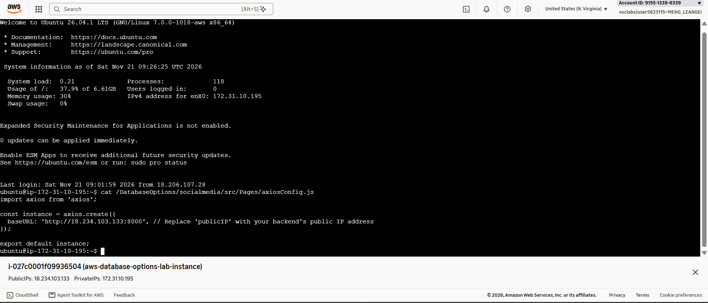

# Cloud Lab 5 Submission — AWS Database Lab

- **Student name:** MENG LEANGEI
- **Student ID:** e20221618
- **Learner Lab user name:** voclabs/user5623115=MENG_LEANGEI
- **Date completed:** 2026-11-22

---

## 1. Security Group Rules

`aws-database-options-security-group` with its inbound and outbound rules.

## 2. EC2 Instance Running

`aws-database-options-lab-instance` is in the **Running** state.

## 3. S3 Bucket

The `leangei-bucket` S3 bucket permissions show its public-access setting and bucket policy section.

## 4. RDS DB Instance

`aws-dbo-sql` is a `db.t4g.small` MySQL instance with status **Available**.

The EC2 instance connected to RDS and created the `educative_db` database and `user_post` table.

## 5. Aurora DB Status

The `aws-dbo-aurora` cluster is **Available** and contains the `aws-dbo-aurora-instance-1` writer instance.

The Aurora connection setup and reader/writer endpoint configuration are also captured below.

## 6. DynamoDB Table

The `posts` table is **Active** and uses `post_id` as its partition key.

## 7. Application Configuration and Testing

The EC2 terminal shows the application backend configuration and public IP used to configure the frontend/backend connection.

> **Missing submission evidence:** the `npm start` screenshot, browser screenshot at port `5173`, and final infrastructure collage were not available in the existing Lab 5 image folder. These must be added before final submission.

## Questions

1. **Which instance answers the Aurora reader endpoint, and why does the application still work?**

   With no Aurora Replica, the reader endpoint points to an instance that can accept reader connections. In an Aurora cluster with only one instance, that instance is the primary/writer instance. The application works because its SQL connection to the reader endpoint is routed to the available primary instance, and the primary can execute reads while also handling writes.

2. **What does each post table store, and how does `/get_posts` join them?**

   The RDS `user_post` table stores the post ID and username—the relational metadata that links a post to its author. The DynamoDB `posts` table stores the post content and related post data keyed by `post_id`. `/get_posts` reads the post metadata from RDS and then uses each `id`/`post_id` as the lookup key in DynamoDB to retrieve the corresponding content, combining the username and content in the returned result.

3. **What happens if the same user publishes two posts in the same second, or on two different days at the same time?**

   The post ID is `username + time in %H:%M:%S` format, so two posts by the same user in the same second produce the same ID and overwrite or collide instead of representing two distinct posts. Two posts on different days at the same time also have the same time-based ID because the date is not included, so they collide for the same reason.

4. **Why does post content go into DynamoDB instead of a SQL table?**

   DynamoDB is used for the post content because this part of the data is large and well suited to key-based access: the `post_id` directly identifies a post and retrieves its content. RDS remains responsible for the small, relational metadata in `user_post`. This separation is intended to scale post content storage independently while keeping author/post relationships in SQL.

5. **Name one risk of storing plaintext passwords and allowing public S3 reads.**

   Storing passwords exactly as typed is unsafe because anyone who obtains the database will immediately know every user's password. The plaintext value is also vulnerable to reuse if users use the same password elsewhere. Allowing anyone to read S3 objects can expose uploaded data to the public and allow unauthorized copying or distribution of user images/content.

## Clean up

- [ ] EC2 instance terminated and `aws-database-options-security-group` deleted.
- [ ] RDS instance `aws-dbo-sql` and Aurora cluster `aws-dbo-aurora` deleted.
- [ ] S3 bucket emptied and deleted.
- [ ] DynamoDB table `posts` deleted.
-
